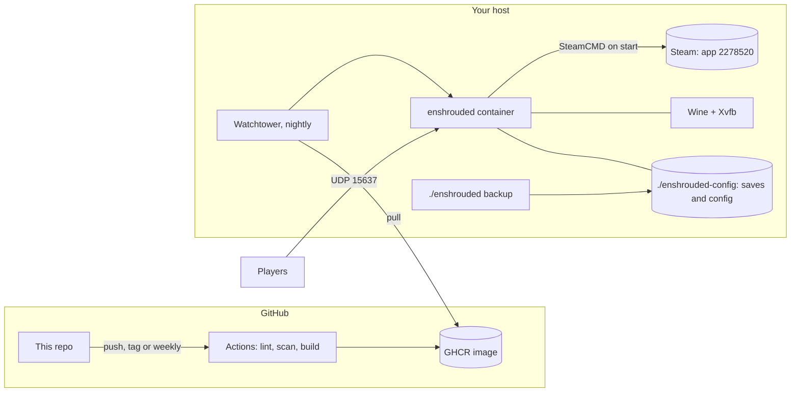

<p align="center">
  
</p>

<h1 align="center">Enshrouded Dedicated Server</h1>

<p align="center">
  A self-hosted Enshrouded dedicated server for Linux that keeps itself patched and your world safe.<br>
  Docker image, one CLI, real backups, no root, no Windows box required.
</p>

<p align="center">
  <a href="https://mrguato.github.io/enshrouded-docker/"><b>Docs</b></a> ·
  <a href="https://github.com/MrGuato/enshrouded-docker/pkgs/container/enshrouded-docker"><b>Container image</b></a> ·
  <a href="https://github.com/MrGuato/enshrouded-docker/releases"><b>Releases</b></a> ·
  <a href="https://github.com/MrGuato/valheim-game-server"><b>Valheim server</b></a>
</p>

<p align="center">
  <a href="https://github.com/MrGuato/enshrouded-docker/releases"></a>
  <a href="https://github.com/MrGuato/enshrouded-docker/actions/workflows/build.yml"></a>
  <a href="https://github.com/MrGuato/enshrouded-docker/actions/workflows/lint.yml"></a>
  <a href="https://github.com/MrGuato/enshrouded-docker/actions/workflows/security.yml"></a>
  <a href="https://github.com/MrGuato/enshrouded-docker/actions/workflows/github-code-scanning/codeql"></a>
  <a href="LICENSE"></a>
  <a href="https://github.com/MrGuato/enshrouded-docker/commits/main"></a>
  <a href="https://github.com/MrGuato/enshrouded-docker/pkgs/container/enshrouded-docker"></a>
</p>

---

```bash
git clone https://github.com/MrGuato/enshrouded-docker.git
cd enshrouded-docker
./enshrouded setup     # asks a few questions, writes .env
./enshrouded start     # pulls the image, downloads the game, tails the log
```

When the log says `[Session] 'HostOnline' (up)`, your friends find the server in the in-game browser or join with `your.public.ip:15637`. That's it.

Fresh Linux host with no Docker yet? One line installs Docker, asks for a server name and password (Enter generates one), opens the firewall and starts the server:

```bash
curl -fsSL https://raw.githubusercontent.com/MrGuato/enshrouded-docker/main/setup.sh | bash
```

## Why this one

Enshrouded only ships a Windows dedicated server, so on Linux it has to run under Wine. Getting that right in a container is fiddly: SteamCMD has to be forced to fetch the Windows build, Wine needs a prefix and a virtual display, Xvfb leaves lock files behind when a container dies, and saves end up buried in the game files if you aren't careful. I worked through all of it so you don't have to, and every feature below is there because I needed it.

**Your world comes first**
- Saves and config live in `./enshrouded-config`, never in the game files. Saves left in the game folder by older setups are moved over automatically.
- `./enshrouded backup` makes a verified tarball of the world saves and server config with retention, and `./enshrouded restore` puts one back (it stops the server first so nothing overwrites it).
- `./enshrouded stop` and Docker stops send the server Ctrl+C through Wine and give it up to 90 seconds to exit before anything gets killed.
- Bad settings fail loudly before the game starts: slot counts, ports, the difficulty preset and the voice chat mode are checked up front, with a clear message.

**Set it up once, then forget it**
- One CLI for everything: `setup`, `start`, `status`, `logs`, `backup`, `restore`, `update`, `shell`. `make` works too.
- The image only carries SteamCMD and Wine. The game is checked and patched on every start, so the image never goes stale when Keen ships an update. A restart is a game update.
- Every setting lives in one `.env` file and is written into `enshrouded_server.json` on start, without touching your custom difficulty settings. Role passwords for Admin, Friend and Guest are built in.
- Watchtower checks for a new image once a night at 05:00 and only touches this container.

**Safe by default**
- The server runs as an unprivileged user (UID 1000), not root.
- Nothing from GitHub can reach your host: there's no self-hosted runner or deploy hook. Your host pulls a public image, and that's the only connection.
- The image is built in the open by GitHub Actions. Every change goes through hadolint, shellcheck, CodeQL, gitleaks and Trivy (config and image scans), it's rebuilt weekly for Ubuntu and Wine security fixes, and Dependabot keeps base images and actions current.
- The server config holds your passwords, so it's kept at mode 600 and backups are readable by their owner only.
- Versioned releases (`IMAGE_TAG=1.0.0`) let you pin exactly what you run.

### Compared with the usual options

|                                   | This repo | Windows PC or VM | Rented game host |
| --------------------------------- | :-------: | :--------------: | :--------------: |
| Runs on a Linux box               | Yes | No | n/a |
| Five-minute setup                 | Yes | Yes | Yes |
| You own the world files           | Yes | Yes | Depends |
| Game patches on restart           | Yes | Manual | Yes |
| Backups with restore              | One command | DIY | Usually |
| Role passwords from one file      | Yes | Edit JSON by hand | Panel |
| Runs as non-root                  | Yes | No | n/a |
| Monthly cost                      | Your hardware | A Windows license and your hardware | A monthly fee |

This repo stays small on purpose, so you can read all of it in an evening and know what runs on your machine.

## Everyday commands

```bash
./enshrouded status       # container, health, server info, whether the session is online
./enshrouded logs         # follow the log
./enshrouded restart      # restart and pick up game patches
./enshrouded update       # pull the newest image and recreate (also applies .env changes)
./enshrouded backup       # verified tarball of saves and config into ./backups
./enshrouded restore FILE # put a backup back
./enshrouded stop         # stop cleanly
./enshrouded shell        # shell inside the container
./enshrouded help         # everything else
```

## How it fits together



## Requirements

| Component      | Minimum |
| -------------- | ------- |
| OS             | Ubuntu 22.04+, Debian 12+, Fedora or Arch (any x86_64 Linux with Docker should work) |
| Docker         | 24.x or newer, with Compose v2 |
| CPU            | 4 x86_64 cores. ARM hosts can't run it, the server needs Wine on x86_64 |
| RAM            | 8 GB, 16 GB for a full 16-player server |
| Disk           | 12 GB free (about 6 GB of game files plus the Wine prefix) |
| Network        | UDP 15637 forwarded |

## Documentation

The full guide is at **[mrguato.github.io/enshrouded-docker](https://mrguato.github.io/enshrouded-docker/)**:

- [Installation](https://mrguato.github.io/enshrouded-docker/installation.html): the one-line installer or a manual setup, to first login
- [Configuration](https://mrguato.github.io/enshrouded-docker/configuration.html): every variable, passwords and roles, volumes and ports
- [Updates](https://mrguato.github.io/enshrouded-docker/updates.html): game patches, image updates, pinning a release
- [Backups](https://mrguato.github.io/enshrouded-docker/backups.html): local, scheduled, off-host, restore
- [Security](https://mrguato.github.io/enshrouded-docker/security.html) and [Troubleshooting](https://mrguato.github.io/enshrouded-docker/troubleshooting.html)

## What's in the repo

```
enshrouded-docker/
+-- enshrouded               The CLI (run this)
+-- setup.sh                 One-line installer for fresh hosts
+-- Dockerfile               Ubuntu 26.04 + SteamCMD + WineHQ + Xvfb
+-- docker-compose.yaml      The server (image from GHCR) + Watchtower
+-- docker-compose.dev.yml   Override for local builds
+-- docker-entrypoint.sh     Starts as root: fixes volume ownership, drops to PUID/PGID
+-- entrypoint.sh            Validates settings, updates the game, writes the config, starts it under Wine
+-- healthcheck.sh           Container health probe
+-- scripts/backup.sh        Verified tarballs with retention
+-- scripts/restore.sh       Restore from a tarball
+-- docs/                    The documentation site (Just the Docs)
+-- .github/workflows/       Build and publish, lint, security scans (CodeQL runs as GitHub default setup)
```

Only infrastructure code lives here: no game files, saves, server addresses or secrets. `.env` is gitignored.

## Releases and versioning

`latest` follows `main`. Tagged releases (`1.0.0`, `1.0`) stay put, so set `IMAGE_TAG=1.0.0` to pin one and update when you choose. What changed in each release is in the [CHANGELOG](CHANGELOG.md) and on the [releases page](https://github.com/MrGuato/enshrouded-docker/releases).

## Contributing and security

Issues and pull requests are welcome. For a security problem, please follow [SECURITY.md](SECURITY.md) instead of opening a public issue.

## License

[MIT](LICENSE). Enshrouded is a trademark of Keen Games GmbH. This project isn't affiliated with Keen Games; it downloads the official dedicated server from Steam at runtime and doesn't redistribute any game files.

See you in Embervale!
